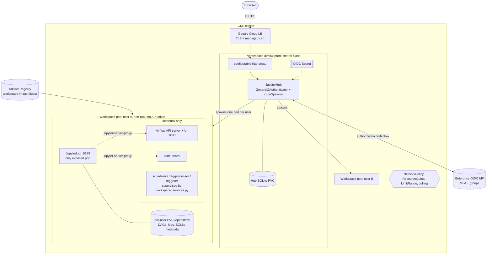
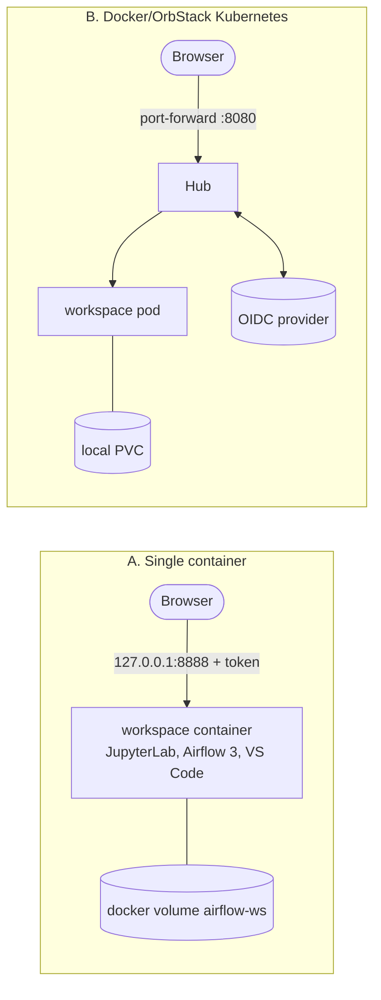

# Architecture (`prod-airflow3`)

## Production topology (GKE)

Request path: browser → LB → proxy → Hub (OIDC login) → the user's own
JupyterLab → `jupyter-server-proxy` → Airflow UI or VS Code. Nothing except
JupyterLab listens off-loopback, so another user cannot reach your Airflow.

Airflow 3 task execution: workers call the API server on `127.0.0.1:9091` and keep
the `${JUPYTERHUB_SERVICE_PREFIX}airflow-api/execution/` path prefix.

## Local topologies

## DAGs folder selection

`AIRFLOW__CORE__DAGS_FOLDER` is only the default (Dockerfile and chart `extraEnv`).
`workspace_services.py` overrides it per child process from
`$AIRFLOW_HOME/.airflow/dags_folder`, written by the Services page form or
`workspace-dags <path>`. A path must exist and sit inside `$AIRFLOW_HOME`
(excluding `.airflow` and `logs`). Switching stops all three services and starts
dag-processor first. `.airflow/workspace.env`, sourced from `~/.bashrc`, keeps
terminal `airflow` commands in step. The api-server is not restarted: it reads
serialized DAGs from the metadata DB, so the UI follows once the dag-processor has
parsed the new folder.

## Where things live

| Concern | Location |
| :-- | :-- |
| Workspace image | `images/workspace/` (`Dockerfile`, `bin/start.sh`, `bin/workspace_services.py`, `bin/workspace-dags`, `vscode/launch.json`) |
| Hub chart | `charts/airflow-dev-platform/` (z2jh 4.4.2 subchart) |
| Per-environment values | `environments/{dev,prod}.values.yaml` |
| Pinned versions | `VERSIONS.env` |
| Build / deploy | `scripts/build-image.sh`, `scripts/deploy.sh` |

Gaps against the full production plan are listed in `prod_plan.md` (e.g. Hub still on
SQLite, no signing or admission policy).
